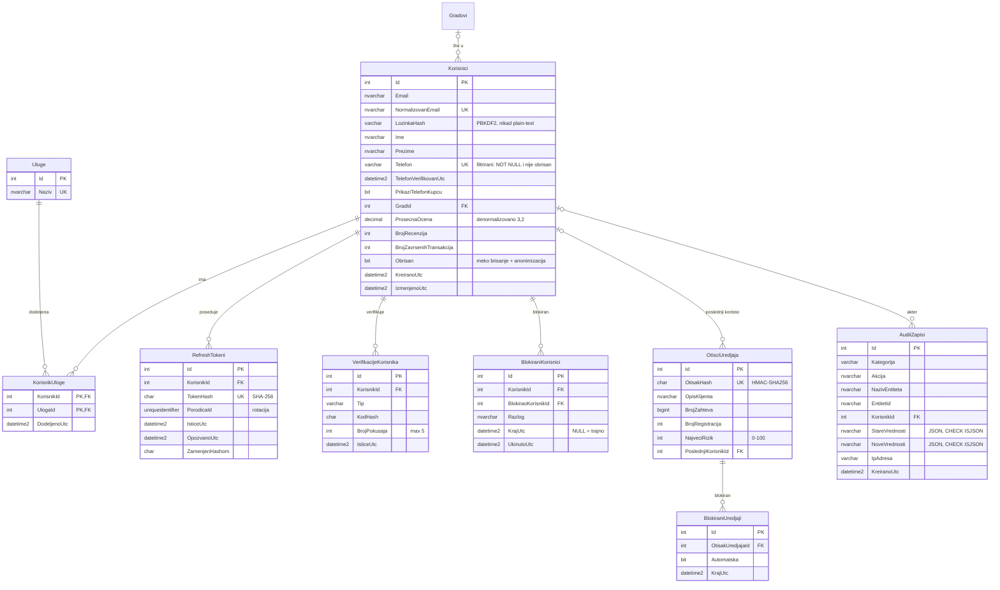
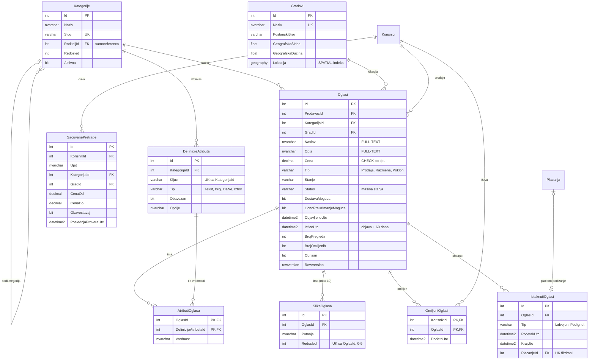
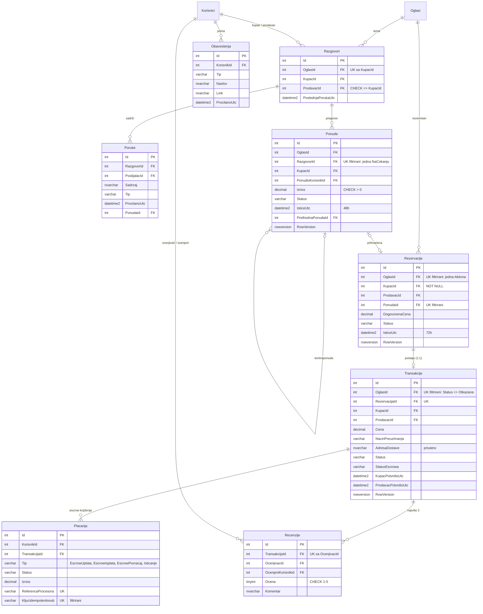
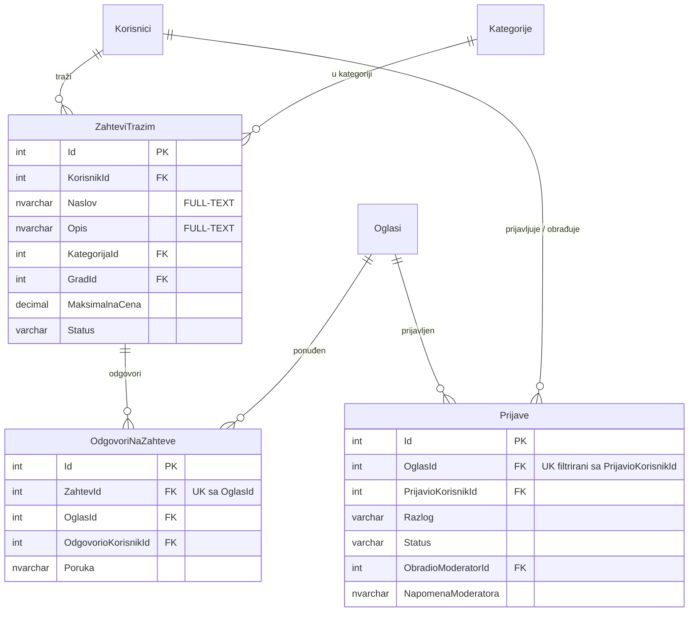

# ER dijagram baze RetroFit

Baza ima **29 tabela**. Dijagram je u Mermaid formatu (GitHub ga prikazuje automatski; lokalno u VS Code uz ekstenziju *Markdown Preview Mermaid Support*).
Oznake: `PK` primarni ključ, `FK` strani ključ, `UK` jedinstveno (UNIQUE) ograničenje. Detaljna objašnjenja su u [baza-podataka.md](baza-podataka.md).

## 1. Korisnici i bezbednost

## 2. Katalog i oglasi

## 3. Komunikacija, rezervacije i transakcije

## 4. Zahtevi "Tražim..." i moderacija

